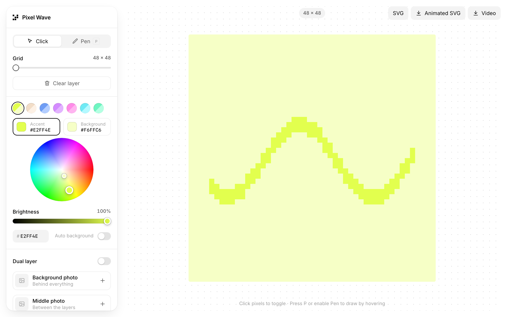

# Pixel Wave

Draw pixel art on a grid, animate it as a scrolling wave, and export it as SVG or video. Everything lives in a single HTML file: there's nothing to build or install, and no dependencies.

**[▶ Try it live](https://jmackow.github.io/pixel-wave/)**

## Run it locally

Clone the repo and open `index.html` in a browser.

## Features

- **Drawing.** Click a cell to toggle it, or switch to the pen (press <kbd>P</kbd>) and paint by hovering.
- **Grid size.** From 10 × 10 up to 48 × 48.
- **Colors.** Pick an accent and a background color on an HSV wheel or by typing a hex value. You can also let the background follow the accent automatically as a light tint, or start from one of the presets.
- **Layers and photos.** Draw on two pixel layers, with optional photos behind everything and between the layers.
- **Motion.** The drawing scrolls left, right, up or down with a sine wobble, either looping or running once.
- **Export.** Three options:
  - **SVG** shows the SVG code for the current layer.
  - **Animated SVG** downloads a looping SMIL animation.
  - **Video** downloads a `.webm` recording.

Video export uses `MediaRecorder` and works in current Chrome and Firefox.

## License

[MIT](LICENSE)
